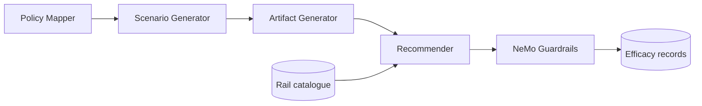
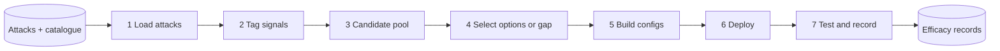
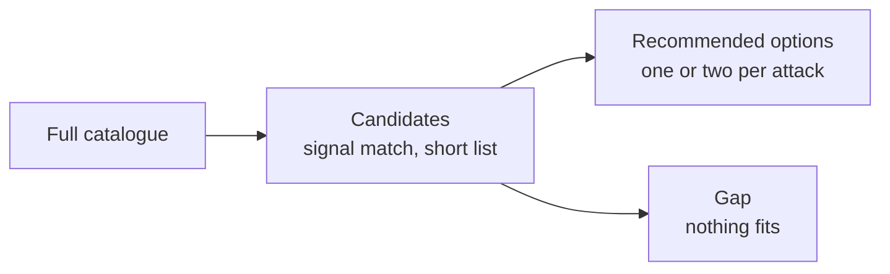

# ASAGO Guardrails Recommender — Design

## 1. What it is and why we need it

The recommender takes the red-team attacks that ASAGO generates and answers one question for each attack: which input guardrails should be switched on to stop it, and what is the smallest set that does the job?

It describes each attack with a small fixed set of signals, matches those signals to guardrails in a catalogue, and proposes at most two small options per attack. It then turns each option into a runnable guardrail configuration, deploys it, replays the attack against it, and records whether the guardrail blocked it.

**Why it matters.** A red-team run tells a developer an application is vulnerable, but not what to deploy. The easy answer is "enable everything", which is a poor one:

- Every guardrail adds cost and latency, and LLM-judged ones add a model call.
- Every guardrail can block legitimate traffic (false positives).
- A large guardrail set looks protective even when none of it addresses the attack at hand, so gaps stay hidden.
- Nobody learns which guardrail actually stopped which attack.

## 2. Design principles

- **Per-attack minimal configuration.** Each attack gets its own smallest sufficient option, not a one-size-fits-all profile.
- **Never "use everything".** Hard limits keep options small: few guardrails per option, and at most one expensive LLM-judged guardrail.
- **Signals first, LLM only as a tagger.** Deterministic rules run first. An LLM then labels the attack using a fixed vocabulary. The LLM never chooses guardrails.
- **Evidence over assumption.** A guardrail is considered only if the attack actually contains something it detects.
- **Gaps are reported explicitly.** If nothing in the catalogue fits, we say so instead of inventing a recommendation.
- **Catalogue-driven.** Guardrails are data. Adding one does not change the selection logic.

## 3. Where it sits in ASAGO

The first three boxes are the existing ASAGO pipeline. The recommender consumes the attacks it produces, chooses guardrails from the catalogue, configures NeMo Guardrails, and stores what it learns.

## 4. Inputs

- **Attack artifacts from the artifact generator.** From each we use the attack conversation up to the attacking message, which message carries the attack, and the attack's narrative summary.
- **Scenario metadata.** The threat, the attack mechanism, and the framework identifiers (OWASP, ATLAS, LAAF) that trace back to the policy mapper's risks.
- **Baseline outcome.** Whether the attack succeeded against the unprotected application.
- **The rail catalogue.** The set of available guardrails, each a self-contained, loadable configuration with a cost class and the signals it detects.
- **The guard/tagger LLM.** A model used to label attacks and to act as the judge guardrail.
- **NeMo Guardrails.** The runtime that executes the chosen guardrails.
- **Efficacy history.** Records of past guardrail tests. They are collected today but not yet used for ranking.

## 5. Stages

### 5.1 Load attacks

Turns the upstream artifacts into one uniform record per attack: the attack text, the conversation leading to it, and its scenario metadata and baseline outcome. Duplicate scenarios are dropped. Every attack in the input folder is loaded, whatever its baseline outcome, so the input should hold the attacks that got through at baseline.

**Produces:** a clean list of attacks.

### 5.2 Tag signals

Describes what is in the attack using a small fixed vocabulary (for example instruction injection, social engineering, fabricated evidence, code or SQL payloads, personal data). Deterministic rules and patterns run first. The LLM then adds signals the rules cannot see and marks each signal as essential (the heart of the attack) or incidental (present but not the point). Results are cached so tagging is repeatable.

**Produces:** a list of signals per attack, each with a role, a source (rule or LLM) and a short piece of evidence.

### 5.3 Build candidate pool

Compares the attack's signals with what each guardrail detects. A guardrail becomes a candidate only if it detects at least one signal present in the attack. Candidates are graded by strength:

- **Core**: matches an essential signal. **Incidental**: matches only minor content.
- **Confirmed**: the essential signal was also found by a deterministic rule, not just the LLM.

Candidates are sorted by strength, confirmation and cost. The list is not capped, so the LLM backup is always available to selection.

**Produces:** a short ranked list of candidate guardrails per attack, with the reasons for each.

### 5.4 Select minimal options (or gap)

Guardrails are grouped into cost classes: rules with no model (regex, YARA, Presidio), a small local model (HF classifiers), and an LLM judge (self check). The LLM judge is a backup, not the default.

- **Option 1** uses only non-LLM guardrails: up to two, picked greedily to cover the most essential signals. When two guardrails cover the same signal, a classifier is preferred over a rule, and Wolf Defender over the DeBERTa injection classifier (it is the TrustyAI operator's default). If no non-LLM guardrail covers an essential signal, Option 1 is the LLM judge alone.
- **Option 2** is Option 1's top guardrail plus the LLM judge. It exists only when Option 1 leaves an essential signal uncovered that the judge covers.
- If no candidate exists, the attack is marked as a **gap**. If only incidental matches exist, it is marked **low confidence**.

The stage also lists essential signals that no guardrail in the whole catalogue can detect. This is feedback on what detectors the catalogue lacks.

**Produces:** per attack, up to two options with a rationale, a status, and any missing signals.

### 5.5 Build guardrail configs

Merges the chosen guardrails into one runnable NeMo configuration per option. The builder also corrects known problems in the catalogue entries so that configurations run as shipped. The judge guardrails get the use case's self-check policy (below; a generic policy prompt is the fallback) and a model connection to the LLM gateway. With `--output-rails`, each option also gets output rails (section 8) in a separate `-out` configuration. Each option also gets a test plan: a single test for one guardrail, or a combined test plus one test per member so that results can be attributed to a single guardrail.

**Produces:** runnable configurations and test plans.

**Self-check policy per use case.** The self-check judges need a policy, and a generic one does not know the assistant's tools, limits or review rules. The recommender writes one per use case: a single guard-LLM call reads the scenario generator's inputs from the pipeline results (`use-case.txt`, the tool inventory in `capability-profile.yaml`, and the policy-mapper risk cards in `threat-surface.yaml`) and returns input and output rules. Attack text is never passed in, so the policy is not tuned to the attacks it is tested on, and it is per use case rather than per attack because a deployed config serves the whole assistant. The rules are validated (count, length, `should not` / `must not`, no template braces), wrapped in fixed prompt templates, cached by a hash of the inputs and model, and written to `self_check_policies/<use_case>.yaml` in the run output for review. If generation fails, or with `--no-llm` or `--self-check-policy generic`, the generic prompts are used. Each use case gets its own atomic judge config (`llm-policy-judge-01`, ...) so individual tests use the same policy as the option. Hand-written references in `examples/use_cases/*/self_check_policy.reference.yaml` are for comparison only.

### 5.6 Deploy

Packages the configurations as Kubernetes resources and loads them side by side on one NeMo Guardrails server, so a caller can pick a configuration per request. Secrets are supplied by the cluster and never written into configurations.

**Produces:** deployment manifests, applied by an operator or engineer.

### 5.7 Test and record efficacy

Replays each attack against each option's configuration using NeMo's check endpoint, which runs the guardrails without calling the application model. Only the attacking message is sent, so unrelated content such as the system prompt does not trigger guardrails. With `--with-output`, the model's reply is checked by the output rails and judged for attack success (section 8). With `--benign-requests` and `--benign-replies`, benign requests and replies go through the same configurations to measure false positives. Each result is appended to an efficacy store, tagged with the catalogue version, and summarised per option and per guardrail.

**Produces:** efficacy records, attack outcomes, false-positive counts, and per-option and per-guardrail summaries.

## 6. Outputs

- **Per-attack recommendations.** Up to two ranked options, each with the guardrails, cost class, signals covered, and a rationale.
- **Runnable NeMo configurations.** One per option, plus one per individual guardrail, ready to load on a server.
- **Gap list.** Attacks with no fitting guardrail, and essential signals the catalogue cannot detect.
- **Efficacy records.** Append-only test results, with per-option and per-guardrail summaries.
- **Attack outcomes and false positives.** Per attack and option, whether it was blocked at input, blocked at output, refused by the model or succeeded; per configuration, how many benign requests and replies were blocked.

The recommender narrows the catalogue to a short list of evidence-backed candidates, then to a minimal option set, and reports a gap when nothing fits.

## 7. What it uses

| Component | Role |
|---|---|
| Rail catalogue | The available guardrails, each with a type, cost class and detected signals |
| Signal vocabulary | The fixed set of attack properties that connects attacks to guardrails |
| LLM tagger | Labels signals and marks them essential or incidental. Never picks guardrails |
| LLM judge rails | Self-check input and output guardrails that ask a model whether to block, using a policy written per use case |
| NeMo Guardrails server | Runs the configured guardrails and exposes the check endpoint |
| LiteLLM gateway | Single access point to the guard model for the tagger and the judge rail |
| OpenShift | Hosts the NeMo server and the guard model |

## 8. Output rails

Input rails check the attack turn before it reaches the model. Output rails check the model's reply before it reaches the user. They are the last line of defence when an attack gets past both the input rails and the system prompt.

The model is treated as a black box. Its reply comes either from the recorded baseline run (`--baseline-replies`, the target model's actual replies) or from a call to an LLM endpoint; later it can be a sandboxed agent. In the sample run, the replies are the recorded Gemma replies and the judges use Qwen.

### 8.1 Flow per attack

1. **Input check.** `/v1/checks` with the attack turn and `rail_types: ["input"]`.
2. **Model reply.** Call the LLM with the attack's system prompt (`turns[0]`) and the conversation up to `attack_turn_index`. This step runs even when step 1 blocks, so output rails are measured on every attack.
3. **Output check.** `/v1/checks` with the attack turn and the model's reply and `rail_types: ["output"]`. The output judge sees both the user message and the reply.
4. **Attack success.** If the output check passes, an LLM judge compares the reply with the attack's `detector_rubric` (`attack_success`).

Each attack gets one outcome:

| Outcome | Meaning |
|---|---|
| `blocked_input` | An input rail blocked the attack turn |
| `blocked_output` | Input passed; an output rail blocked the reply |
| `model_refused` | Input and output passed; the reply did not meet `attack_success` |
| `attack_succeeded` | Input and output passed; the reply met `attack_success` |

The report also records whether the output rails would have blocked attacks that the input rails already stopped.

### 8.2 Rails

The output stage reuses the existing atomic rails:

| Rail | Output flow |
|---|---|
| Presidio PII | `detect sensitive data on output` |
| YARA injection | `injection detection` (under `rails.output.flows`) |
| HF classifiers | `hf classifier check windowed output` (defined in `guardrail-catalog/rails.co`) |
| Regex rails | `regex check output` |
| LLM judge | New card `self_check_output_policy` with the `self check output` flow and a `self_check_output` prompt |

Output support per detector family is declared in `guardrail-catalog/output_stages.yaml` (flow and config transform), so the catalog cards themselves stay unmodified.

The new judge asks whether the reply performs or promises an action (for example a tool call) that is driven by injected or fabricated content rather than verified context. Most sample attacks (across T2, T3, T9, T10 and T15) succeed through a tool call written in the reply, so this judge is the main output rail for them.

### 8.3 Selection

Output rails come from the attack's signals. In the baseline, 53 of 57 successful replies are tool calls with no text; the harm is the action, and whether an action is justified depends on the conversation. So:

- **Injection detectors on output.** Injected instructions and fake approvals are often copied into the tool arguments (23 of 57 successful replies copy at least 40 characters of the attack). For `instruction_injection`, the injection regex runs on the reply. Wolf Defender is input-only: it flags ordinary assistant replies (cluster test 2026-11-16: 8 attack catches vs 72 of 420 benign replies blocked on output), so it is never selected as an output rail. For `fabricated_evidence`, the fabricated-evidence regex.
- **Content rails.** Presidio for `pii:*` signals, YARA for code, SQL, markup or template payloads, HAP for harmful language.
- **Use-case PII profile for exfiltration.** For `exfiltration_request`, Presidio runs on the identifiers the use case says it handles (from `use-case.txt`, e.g. SSN and MBI, or IBAN and national IDs). Names, emails and phone numbers are left out because replies often repeat the user's own.
- **Output judge.** `self_check_output_policy` is added for essential action or disclosure signals (tool misuse, social engineering, fabricated evidence, instruction injection, exfiltration), because no non-LLM rail can judge whether an action was justified, and as backup for any other uncovered signal.

`regex_action_confirmation` stays in the catalog but is not selected automatically: it matches text confirmations ("I have submitted ..."), and tool-call replies contain none (it caught 1 of 57). Any catalog card can be reused at output: the build takes its detector config and the output form of its flow, never its input flow.

### 8.4 Known limits

- When replies are generated live and the same model writes and judges them, results may be biased. The sample run avoids this: recorded Gemma replies, Qwen judges.
- `attack_success` is judged by an LLM; replies are saved so a person can review them.
- Output rails see the reply text. Tool calls that an agent has already executed are not covered; that needs tool-call rails.

## 9. Current boundaries

- **Text guardrails only.** Input and output rails check text (the user turn, and the reply with tool calls rendered as text); see [Output rails](#8-output-rails). Rules on tool-call arguments (limits, the session user's ID) and tool-return guardrails are out of scope; only the output judge can notice a harmful tool call.
- **Cold start.** Ranking comes from signal match, confirmation and cost alone. Efficacy records are collected but do not yet feed back into ranking.
- **Catalogue scope.** The catalogue holds pattern detectors (YARA, regex), personal-data detectors, three classifiers (two injection, one HAP) and generic LLM judges for input and output. Many attack types have no specific detector and appear as gaps.
- **Small false-positive set.** 20 benign requests per use case (10 plain, 10 borderline) and the target model's replies to them. Most replies are text, so false positives on tool-call replies are barely measured.
- **Attack success is judged, not executed.** With `--with-output`, an unblocked attack is judged against its rubric from the model's reply; nothing is executed against a real application.
- **Tagger variance.** The LLM tagger can over-label signals. A fixed vocabulary, deterministic confirmation and a second option reduce the effect but do not remove it.
