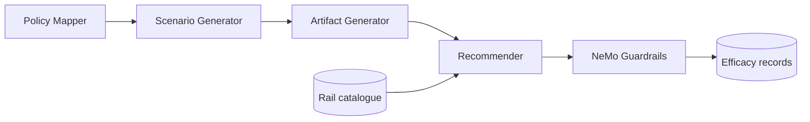
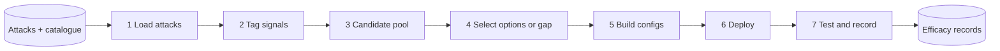
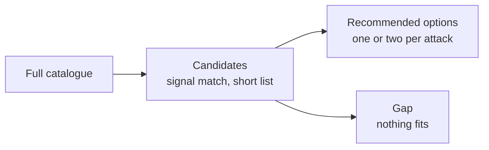

# ASAGO Guardrails Recommender — Design

## 1. What it is and why we need it

The recommender takes the red-team attacks that ASAGO generates and answers one question for each attack: which input guardrails should be switched on to stop it, and what is the smallest set that does the job?

It describes each attack with a small fixed set of signals, matches those signals to guardrails in a catalogue, and proposes at most two small options per attack. It then turns each option into a runnable guardrail configuration, deploys it, replays the attack against it, and records whether the guardrail blocked it.

**Why it matters.** A red-team run tells a developer an application is vulnerable, but not what to deploy. The easy answer is "enable everything", which is a poor one:

- Every guardrail adds cost and latency, and LLM-judged ones add a model call.
- Every guardrail can block legitimate traffic (false positives).
- A large guardrail set looks protective even when none of it addresses the attack at hand, so gaps stay hidden.
- Nobody learns which guardrail actually stopped which attack.

## 2. Design principles

- **Per-attack minimal configuration.** Each attack gets its own smallest sufficient option, not a one-size-fits-all profile.
- **Never "use everything".** Hard limits keep options small: few guardrails per option, and at most one expensive LLM-judged guardrail.
- **Signals first, LLM only as a tagger.** Deterministic rules run first. An LLM then labels the attack using a fixed vocabulary. The LLM never chooses guardrails.
- **Evidence over assumption.** A guardrail is considered only if the attack actually contains something it detects.
- **Gaps are reported explicitly.** If nothing in the catalogue fits, we say so instead of inventing a recommendation.
- **Catalogue-driven.** Guardrails are data. Adding one does not change the selection logic.

## 3. Where it sits in ASAGO

The first three boxes are the existing ASAGO pipeline. The recommender consumes the attacks it produces, chooses guardrails from the catalogue, configures NeMo Guardrails, and stores what it learns.

## 4. Inputs

- **Attack artifacts from the artifact generator.** From each we use the attack conversation up to the attacking message, which message carries the attack, and the attack's narrative summary.
- **Scenario metadata.** The threat, the attack mechanism, and the framework identifiers (OWASP, ATLAS, LAAF) that trace back to the policy mapper's risks.
- **Baseline outcome.** Whether the attack succeeded against the unprotected application.
- **The rail catalogue.** The set of available guardrails, each a self-contained, loadable configuration with a cost class and the signals it detects.
- **The guard/tagger LLM.** A model used to label attacks and to act as the judge guardrail.
- **NeMo Guardrails.** The runtime that executes the chosen guardrails.
- **Efficacy history.** Records of past guardrail tests. They are collected today but not yet used for ranking.

## 5. Stages

### 5.1 Load attacks

Turns the upstream artifacts into one uniform record per attack: the attack text, the conversation leading to it, and its scenario metadata and baseline outcome. Duplicate scenarios are dropped.

**Produces:** a clean list of attacks.

### 5.2 Tag signals

Describes what is in the attack using a small fixed vocabulary (for example instruction injection, social engineering, fabricated evidence, code or SQL payloads, personal data). Deterministic rules and patterns run first. The LLM then adds signals the rules cannot see and marks each signal as essential (the heart of the attack) or incidental (present but not the point). Results are cached so tagging is repeatable.

**Produces:** a list of signals per attack, each with a role, a source (rule or LLM) and a short piece of evidence.

### 5.3 Build candidate pool

Compares the attack's signals with what each guardrail detects. A guardrail becomes a candidate only if it detects at least one signal present in the attack. Candidates are graded by strength:

- **Core**: matches an essential signal. **Incidental**: matches only minor content.
- **Confirmed**: the essential signal was also found by a deterministic rule, not just the LLM.

Candidates are sorted by strength, confirmation and cost, and capped to a short list.

**Produces:** a short ranked list of candidate guardrails per attack, with the reasons for each.

### 5.4 Select minimal options (or gap)

Guardrails are grouped into cost classes: rules with no model, a small local model, and an LLM judge. Cheaper is preferred.

- **Option 1** is the best single guardrail.
- **Option 2** exists only when Option 1 is not confirmed. It adds one cheap guardrail for a different essential signal, within the size limits.
- If no candidate exists, the attack is marked as a **gap**. If only incidental matches exist, it is marked **low confidence**.

The stage also lists essential signals that no guardrail in the whole catalogue can detect. This is feedback on what detectors the catalogue lacks.

**Produces:** per attack, up to two options with a rationale, a status, and any missing signals.

### 5.5 Build guardrail configs

Merges the chosen guardrails into one runnable NeMo configuration per option. The builder also corrects known problems in the catalogue entries so that configurations run as shipped. The judge guardrail is generated with a generic policy prompt and a model connection to the LLM gateway. Each option also gets a test plan: a single test for one guardrail, or a combined test plus one test per member so that results can be attributed to a single guardrail.

**Produces:** runnable configurations and test plans.

### 5.6 Deploy

Packages the configurations as Kubernetes resources and loads them side by side on one NeMo Guardrails server, so a caller can pick a configuration per request. Secrets are supplied by the cluster and never written into configurations.

**Produces:** deployment manifests, applied by an operator or engineer.

### 5.7 Test and record efficacy

Replays each attack against each option's configuration using NeMo's check endpoint, which runs the guardrails without calling the application model. Only the attacking message is sent, so unrelated content such as the system prompt does not trigger guardrails. Each result is appended to an efficacy store, tagged with the catalogue version, and summarised per guardrail from single-guardrail runs only.

**Produces:** efficacy records and a per-guardrail summary.

## 6. Outputs

- **Per-attack recommendations.** Up to two ranked options, each with the guardrails, cost class, signals covered, and a rationale.
- **Runnable NeMo configurations.** One per option, plus one per individual guardrail, ready to load on a server.
- **Gap list.** Attacks with no fitting guardrail, and essential signals the catalogue cannot detect.
- **Efficacy records.** Append-only test results, with per-guardrail summaries.

The recommender narrows the catalogue to a short list of evidence-backed candidates, then to a minimal option set, and reports a gap when nothing fits.

## 7. What it uses

| Component | Role |
|---|---|
| Rail catalogue | The available guardrails, each with a type, cost class and detected signals |
| Signal vocabulary | The fixed set of attack properties that connects attacks to guardrails |
| LLM tagger | Labels signals and marks them essential or incidental. Never picks guardrails |
| LLM judge rail | A generic policy-based guardrail that asks a model whether to block |
| NeMo Guardrails server | Runs the configured guardrails and exposes the check endpoint |
| LiteLLM gateway | Single access point to the guard model for the tagger and the judge rail |
| OpenShift | Hosts the NeMo server and the guard model |

## 8. Current boundaries

- **Input guardrails only.** Output, tool-call and tool-return guardrails are out of scope.
- **Cold start.** Ranking comes from signal match, confirmation and cost alone. Efficacy records are collected but do not yet feed back into ranking.
- **Catalogue scope.** The catalogue holds pattern detectors, personal-data detectors, two classifiers and one generic LLM judge. Many attack types have no specific detector and appear as gaps.
- **No false-positive measurement.** There are no benign test cases yet, so we do not know how much legitimate traffic each guardrail would block.
- **Detection level only.** Tests show whether a guardrail blocks the attack message, not whether an unblocked attack would still compromise the application.
- **Tagger variance.** The LLM tagger can over-label signals. A fixed vocabulary, deterministic confirmation and a second option reduce the effect but do not remove it.
